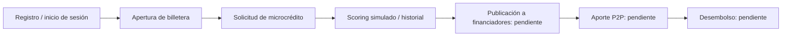

# PayFast — FinTech de microcréditos P2P (prototipo académico)

Proyecto del **Grupo 4 — Ingeniería de Software I (PCIA5008), Universidad Sergio Arboleda**. El objetivo académico es demostrar el flujo de billetera digital, solicitudes de microcrédito, evaluación de riesgo, financiación entre pares y desembolso. **No es un sistema bancario ni un producto apto para operaciones con dinero real.**

## Estado del repositorio (auditoría documental, 17/11/2026)

| Historia Jira | Evidencia encontrada en `main` | Estado de alcance |
|---|---|---|
| [HU-01: registro](https://fintechpayfast.atlassian.net/browse/PFAST4-1) | `POST /auth/register`, `POST /auth/login`, `GET /auth/me`; pruebas en `tests/test_auth_*.py` | Implementación backend; verificar ejecución y aceptación |
| [HU-02: billetera](https://fintechpayfast.atlassian.net/browse/PFAST4-2) | `backend/app/api/wallets.py`, `wallet_service.py` | Implementación backend; verificar ejecución y aceptación |
| [HU-03: solicitar crédito](https://fintechpayfast.atlassian.net/browse/PFAST4-3) | `POST /credit-requests/` y servicio que exige billetera activa | Implementación backend; verificar ejecución y aceptación |
| [HU-04: consultar estado](https://fintechpayfast.atlassian.net/browse/PFAST4-4) | `GET /credit-requests/me` y `GET /credit-requests/{solicitud_id}` | Implementación backend; verificar ejecución y aceptación |
| [HU-05: evaluación de riesgo](https://fintechpayfast.atlassian.net/browse/PFAST4-5) | `POST/GET /credit-requests/{solicitud_id}/risk-evaluations` | **Scoring determinista simulado, NO IA entrenada** |
| [HU-06: catálogo financiable](https://fintechpayfast.atlassian.net/browse/PFAST4-6) | No se encontró endpoint de listado para prestamistas | Pendiente |
| [HU-07: aportes P2P](https://fintechpayfast.atlassian.net/browse/PFAST4-7) | No se encontraron endpoint/servicio de aportes | Pendiente |
| [HU-08: desembolso/transacciones](https://fintechpayfast.atlassian.net/browse/PFAST4-8) | Estados definidos en `domain/states.py`, sin flujo bancario implementado verificado | Pendiente |

> **Importante:** La existencia de código y archivos de pruebas no demuestra que el flujo funcione en la nube ni que cumpla los criterios de aceptación. No marcar historias como «Listo» hasta ejecutar y registrar evidencia.

## Arquitectura identificada

- **API:** Python, FastAPI; rutas en `backend/app/api/`.
- **Dominio y servicios:** `backend/app/domain/` y `backend/app/services/`.
- **Persistencia:** PostgreSQL, SQLAlchemy y migraciones Alembic.
- **Autenticación:** JWT y almacenamiento de contraseñas mediante utilidades de hashing del proyecto.
- **Integraciones:** el buró es un **simulador local** (`credit_bureau_simulator.py`), no una conexión a un buró real.
- **Frontend:** la carpeta `frontend/` no contiene aplicación funcional en el estado auditado.
- **Despliegue cloud:** pendiente de acreditar con URL, capturas, logs y demo.

### Flujo implementado parcialmente

## Ejecución local (requiere Docker y Python)

1. Copiar `.env.example` a `.env` y configurar valores **locales**; nunca subir secretos reales.
2. Iniciar PostgreSQL: `docker compose up -d db`.
3. Desde la raíz, crear entorno: `python -m venv .venv`; activarlo.
4. Instalar dependencias: `pip install -r backend/requirements.txt -r backend/requirements-dev.txt`.
5. Desde `backend/`, ejecutar migraciones: `alembic upgrade head` y configurar roles si corresponde con `python -m app.db.seed`.
6. Desde `backend/`, iniciar: `uvicorn app.main:app --reload`.
7. Consultar `http://127.0.0.1:8000/docs`, `/health` y `/health/database`.

**Nota:** instrucciones de arranque inferidas de la estructura de código y configuración; validar en un entorno limpio antes de tomarlas como evidencia de funcionamiento. Para pruebas, desde la raíz del repositorio ejecutar `pytest -q`; registrar versión, entorno, conteos, errores y fecha. No se ha certificado su resultado en esta auditoría.

## Riesgos y límites de la demostración

1. **No presentar scoring simulado como modelo IA entrenado.** `calcular_puntaje` aplica una fórmula ponderada a datos ficticios; el umbral `>= 50` es una regla codificada pendiente de validación del Product Owner.
2. **No demostrar transacciones reales.** No hay prueba de integración funcional con pasarela bancaria.
3. **Estados != proceso completo.** Definir `EN_FINANCIACION`, `FINANCIADA`, `DESEMBOLSADA` y `EXITOSA` no acredita aportes, conciliación, idempotencia ni desembolso.
4. **Seguridad y calidad:** auditar permisos, operaciones duplicadas, concurrencia, secretos, pruebas de integración y RNF medibles antes del despliegue.
5. **Documentos UML:** `docs/uml/estados.md` incluye diagramas de estados; revisar requisitos de subestados y `after()` exigidos en la rúbrica.

## Entregables pendientes según guía de cátedra

- SRS conforme a ISO/IEC/IEEE 29148: **5 RF + 5 RNF medibles**; trazabilidad con **8 HU** y criterios de aceptación.
- Contexto, casos de uso y especificación textual; actividades con carriles y fork/join balanceados.
- Secuencia UML 2.5 con `alt`, `par`, `loop`; clases de diseño con atributos, métodos, visibilidad y multiplicidades; máquina de estados con subestados y temporizadores cuando corresponda.
- Prototipo **desplegado en la nube**, accesible para demostración del flujo principal.
- Informe SQA: matriz ISO/IEC 25010, resultados de pruebas unitarias e integración, complejidad ciclomática McCabe y DRE **calculados con evidencia**.
- Presentación de **15 minutos**, demostración y defensa técnica.

## Seguimiento

[Tablero Jira PFAST4](https://fintechpayfast.atlassian.net/browse/PFAST4) · [Repositorio](https://github.com/SantiagoRodriguez114/PayFast)

Esta página describe el estado **observado en archivos**, no una certificación de pruebas ni una aceptación funcional. Los cambios de código se deben revisar y fusionar mediante pull request.
