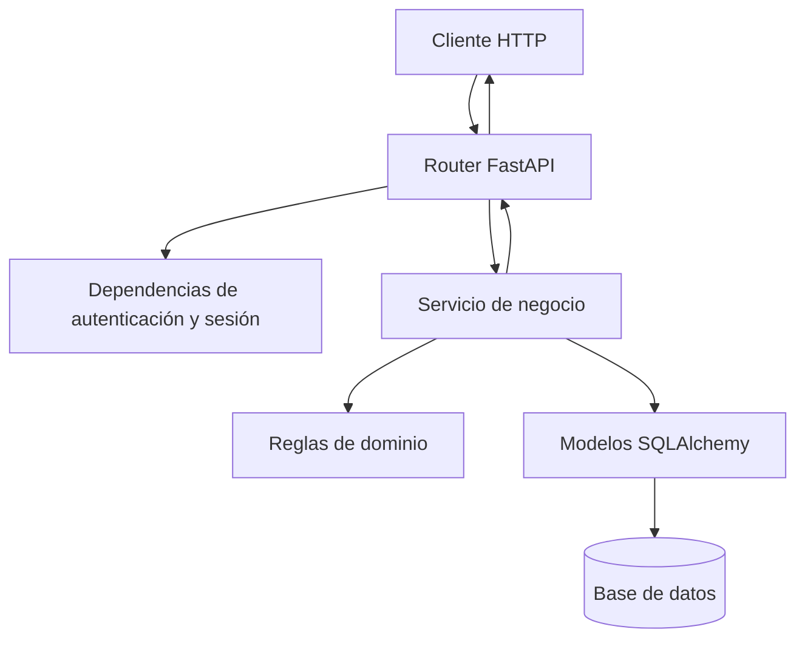

# Arquitectura técnica del backend — PayFast

## 1. Alcance

PayFast es un prototipo académico de financiación P2P. El backend expone una API HTTP con FastAPI, utiliza SQLAlchemy para la persistencia y Alembic para gestionar cambios de esquema.

Este documento describe la estructura observada en el código del proyecto. Las reglas particulares se amplían en `auth.md`, `wallets.md`, `credit_requests.md`, `risk_evaluation.md`, `aportes.md`, `desembolsos.md` y `uml/estados.md`.

## 2. Organización por responsabilidades

| Capa | Ubicación | Responsabilidad |
|---|---|---|
| Aplicación HTTP | `backend/app/main.py` | Inicializar FastAPI, registrar routers y exponer comprobaciones de salud |
| API | `backend/app/api/` | Recibir peticiones, aplicar dependencias de autenticación y traducir resultados o errores a HTTP |
| Esquemas | `backend/app/schemas/` | Validar entradas y definir las representaciones de la API con Pydantic |
| Servicios | `backend/app/services/` | Ejecutar reglas de negocio y operaciones de persistencia |
| Dominio | `backend/app/domain/states.py` | Definir estados y transiciones permitidas |
| Modelos | `backend/app/models/` | Representar entidades y restricciones mediante SQLAlchemy |
| Base de datos | `backend/app/db/` | Registrar modelos, configurar motor y sesiones, y sembrar roles |
| Migraciones | `backend/migrations/versions/` | Versionar los cambios del esquema de base de datos |
| Pruebas | `tests/` | Verificar comportamiento de API, dominio, seguridad y servicios integrados |

### Flujo general de una operación



El diagrama es una vista lógica: no todos los servicios invocan directamente las funciones de validación de transiciones definidas en `domain/states.py`. Algunas operaciones asignan el estado después de comprobar sus propias condiciones de negocio.

## 3. Inicialización y rutas

`backend/app/main.py` crea una instancia de `FastAPI` con título `PayFast API` y versión `1.0.0`. Registra los routers de autenticación, billeteras, solicitudes de crédito y evaluaciones de riesgo. Las operaciones de aportes, desembolsos y consulta de transacciones están integradas en el router de solicitudes.

La aplicación expone además:

| Ruta | Comportamiento |
|---|---|
| `GET /` | Devuelve un mensaje de bienvenida y estado `operational` |
| `GET /health` | Devuelve `healthy` sin consultar la base de datos |
| `GET /health/database` | Ejecuta `SELECT 1`; devuelve `healthy` si funciona o HTTP `503` ante un error de SQLAlchemy |

La documentación OpenAPI se genera automáticamente mediante FastAPI. Debe consultarse junto con la documentación funcional, no como sustituto de ella.

## 4. Persistencia y sesiones

`backend/app/db/base.py` define la clase `Base(DeclarativeBase)` y registra los modelos ORM. Entre las entidades presentes están:

- `Usuario` y `Rol`: identidad y autorización.
- `Billetera`: saldo simulado del usuario.
- `SolicitudCredito`: monto, estado y financiación acumulada.
- `EvaluacionRiesgo`: resultados e intentos de evaluación.
- `Aporte`: contribuciones de prestamistas.
- `Transaccion`: resultados de desembolsos simulados.

`backend/app/db/session.py` configura `create_engine(settings.database_url, pool_pre_ping=True)` y `SessionLocal` con `autoflush=False` y `autocommit=False`. La dependencia `get_db()` abre una sesión para la petición y la cierra en un bloque `finally`.

La URL de conexión procede de `app.core.config.settings`; no debe almacenarse una contraseña real en la documentación ni en el repositorio.

### Relaciones funcionales principales

Un usuario puede tener roles y billeteras; un emprendedor registra solicitudes; cada solicitud puede tener evaluaciones, aportes y transacciones de desembolso. Los aportes relacionan prestamistas con solicitudes. Las transacciones se asocian a una solicitud y a una billetera.

Esta descripción es conceptual y no sustituye un diagrama entidad-relación generado y contrastado con todas las claves foráneas de las migraciones.

## 5. Migraciones

La carpeta `backend/migrations/versions/` contiene siete migraciones, correspondientes a:

1. Usuarios y roles.
2. Billeteras.
3. Solicitudes de crédito.
4. Normalización de estados de solicitudes.
5. Evaluaciones de riesgo.
6. Campo `monto_financiado` en solicitudes.
7. Aportes y transacciones.

Para verificar que el modelo ORM no presenta nuevas operaciones de migración pendientes:

```bash
alembic -c backend/alembic.ini check
```

Esta comprobación no sustituye pruebas de actualización y reversión de migraciones en una base de datos independiente.

## 6. Seguridad y consistencia

El módulo de autenticación utiliza contraseñas derivadas con Argon2id y tokens JWT; las rutas protegidas identifican al usuario mediante dependencias de FastAPI. Las reglas detalladas se encuentran en `docs/auth.md`.

Los montos financieros se representan mediante `Decimal` en Python y `Numeric(18,2)` en los modelos. Los servicios de aportes y desembolsos emplean transacciones y bloqueos de filas (`SELECT ... FOR UPDATE`) pensados para PostgreSQL. La tabla de transacciones define un índice único parcial que impide más de una transacción `EXITOSA` por solicitud.

La protección contra doble acreditación no equivale a idempotencia HTTP completa: un intento repetido puede recibir una respuesta de conflicto.