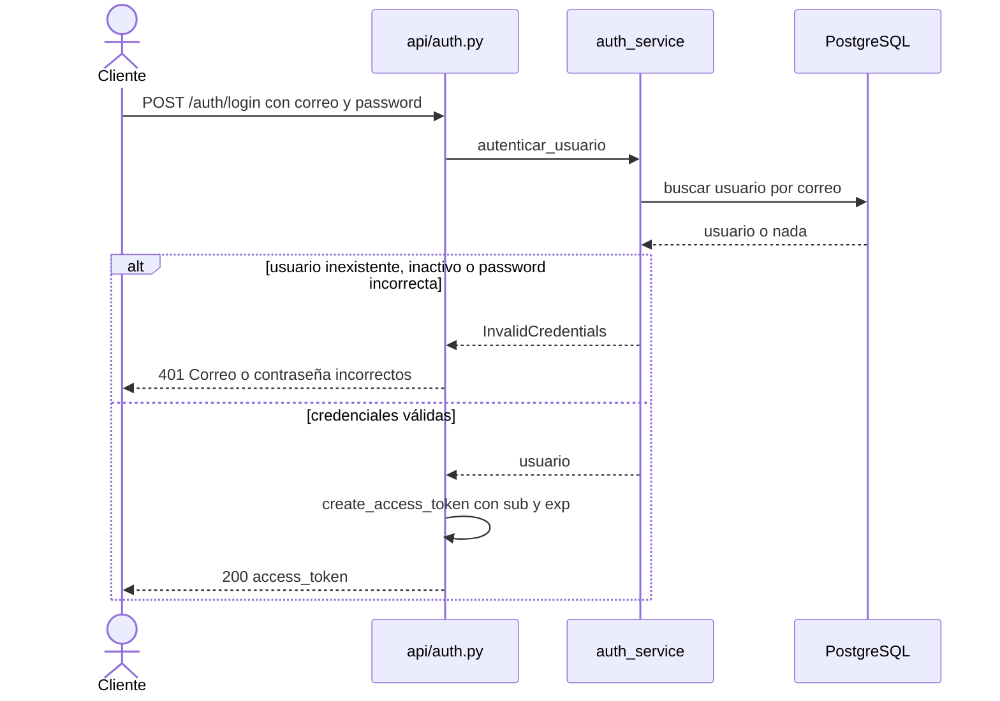
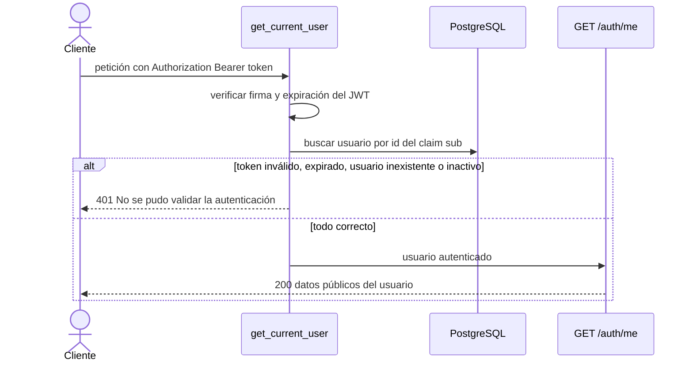

# Módulo de autenticación

Permite que una persona se registre, inicie sesión y acceda a rutas protegidas.
Cubre la parte de registro de **RF-01** (HU-01) y **RNF-02** (contraseñas con
derivación segura y sal) del SRS.

## Archivos del módulo

| Archivo | Responsabilidad |
|---|---|
| `backend/app/api/auth.py` | Los endpoints. Recibe la petición y delega; no contiene reglas de negocio |
| `backend/app/api/dependencies.py` | `get_current_user`: protege rutas identificando al usuario por su token |
| `backend/app/services/auth_service.py` | Reglas de negocio: registrar y verificar credenciales |
| `backend/app/schemas/auth.py` | Qué datos acepta y devuelve la API (validación con Pydantic) |
| `backend/app/core/security.py` | Hash de contraseñas (Argon2id) y creación y verificación de tokens JWT |
| `backend/app/core/config.py` | Lee la clave secreta, el algoritmo y la duración del token desde `.env` |
| `backend/app/models/user.py`, `role.py` | Tablas `usuario`, `rol` y `usuario_rol` |
| `backend/app/db/seed.py` | Inserta los roles iniciales |

## Endpoints

| Método y ruta | Quién | Éxito | Errores |
|---|---|---|---|
| `POST /auth/register` | Público | `201` con los datos públicos del usuario | `409` correo ya registrado · `422` datos inválidos · `500` rol no configurado |
| `POST /auth/login` | Público | `200` con `access_token` y `token_type` | `401` credenciales incorrectas |
| `GET /auth/me` | Usuario con token | `200` con sus datos públicos | `401` token ausente o no válido |

**Registro.** Datos: `nombre` (2 a 120 caracteres), `correo` (con formato válido),
`password` (8 a 128 caracteres) y `rol` (solo `emprendedor` o `prestamista`).
La respuesta nunca incluye la contraseña ni su hash.

**Login.** Devuelve un token JWT. Para usarlo, el cliente envía la cabecera
`Authorization: Bearer <token>` en cada petición a una ruta protegida.

## Decisiones de seguridad

| Decisión | Razón |
|---|---|
| Contraseñas con **Argon2id** (biblioteca `pwdlib`) | Es una derivación de claves diseñada para ser lenta y costosa de atacar. Genera una sal aleatoria por contraseña y la guarda dentro del propio hash. Cumple RNF-02 |
| Límite de 128 caracteres en la contraseña | Argon2 es lento a propósito; sin tope, alguien podría enviar contraseñas enormes para saturar el servidor |
| **JWT firmado** con HS256, con los datos `sub` (id del usuario) y `exp` | El servidor no guarda sesiones: cada token se verifica por su firma. `exp` limita la validez |
| Token válido por **30 minutos** | Si alguien roba un token, deja de servir pronto. Se configura con `ACCESS_TOKEN_EXPIRE_MINUTES` |
| El token **no basta**: `get_current_user` revisa que el usuario siga existiendo y activo | Así, desactivar una cuenta invalida su token aunque no haya vencido |
| **Un solo error** (`401`, "Correo o contraseña incorrectos.") para correo inexistente, contraseña errónea y cuenta inactiva | No revela qué correos están registrados |
| El correo se normaliza (espacios y mayúsculas) | Evita cuentas duplicadas como `Ana@x.co` y `ana@x.co` |
| `UNIQUE` en `usuario.correo` además de la comprobación en código | Si dos registros llegan a la vez, la base impide el duplicado |
| `SECRET_KEY` en `.env`, nunca en el código ni en Git | `.env` está en `.gitignore`; `.env.example` solo lleva un valor de ejemplo |
| Roles sembrados (`emprendedor`, `prestamista`) con `python -m app.db.seed` | El registro busca el rol en la tabla `rol`; sin ese paso responde `500` |

## Flujos

### Inicio de sesión

### Acceso a una ruta protegida

Cualquier ruta futura queda protegida declarando
`usuario: Usuario = Depends(get_current_user)`.

## Pruebas

| Archivo | Pruebas | Qué cubre |
|---|---:|---|
| `tests/test_security.py` | 6 | Hash Argon2id, verificación de contraseñas, creación y rechazo de tokens |
| `tests/test_auth_schemas.py` | 5 | Validación de los datos de entrada |
| `tests/test_auth_api.py` | 8 | Registro (éxito, duplicado, rol inválido) y login (token, contraseña incorrecta, mensaje uniforme, correo normalizado, cuenta desactivada) |
| `tests/test_auth_protected.py` | 10 | Rutas protegidas: sin token, malformado, otro esquema, expirado, firma falsa, sin `sub`, `sub` inválido, usuario inexistente, cuenta desactivada |

Las pruebas de API usan una base SQLite en memoria (fixture `client` en
`tests/conftest.py`), así que no tocan la base de desarrollo.

## Limitaciones conocidas

1. **El tiempo de respuesta del login revela si un correo existe.** Si el correo
   no existe, el servidor responde sin calcular ningún hash; si existe, verifica
   Argon2. Medido en un entorno de pruebas (mediana de 20 intentos con contraseña
   incorrecta): correo inexistente ≈ 3,6 ms, correo existente ≈ 132,5 ms. La
   diferencia permitiría adivinar qué correos están registrados. Mitigación posible:
   verificar siempre contra un hash falso cuando el usuario no existe.
2. **No hay límite de intentos de login**, por lo que un atacante puede probar
   contraseñas sin freno.
3. **El registro revela si un correo ya existe** (respuesta `409`). Es habitual en
   un prototipo, pero permite comprobar qué correos están registrados.
4. **No hay verificación de identidad ni de correo** (el SRS lo deja pendiente,
   sección 1.7).
5. **Los tokens no se pueden revocar** antes de su expiración, salvo desactivando
   la cuenta.
