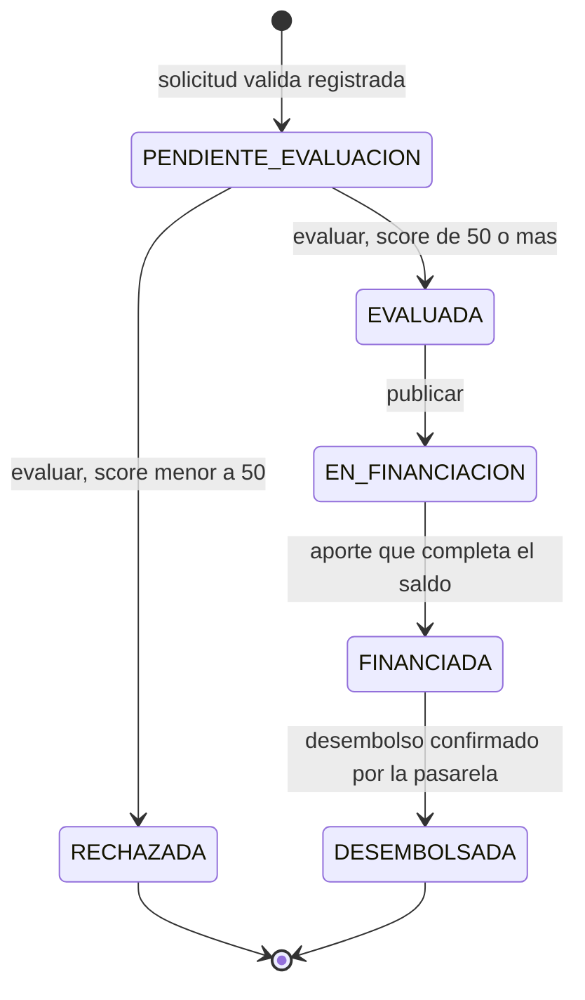
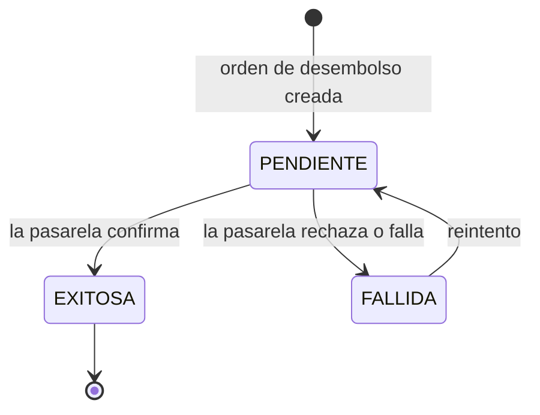

# Máquinas de estados de PayFast

Implementadas en `backend/app/domain/states.py` y verificadas por
`tests/test_state_request.py` y `tests/test_state_transaction.py`.

## SolicitudCredito

| Regla | Dónde se garantiza |
|---|---|
| Toda solicitud válida nace en Pendiente de evaluación (HU-03) | `ESTADO_INICIAL` |
| Evaluar no equivale a aprobar (HU-05, criterio 4) | No existe el salto de `PENDIENTE_EVALUACION` a `EN_FINANCIACION` |
| Solo se desembolsa una solicitud financiada (HU-08) | `DESEMBOLSADA` solo se alcanza desde `FINANCIADA` |
| Un rechazo es definitivo | `RECHAZADA` no tiene salidas |

## TransaccionFinanciera

| Regla | Dónde se garantiza |
|---|---|
| El saldo solo se acredita con confirmación de la pasarela (HU-08, criterio 4) | `EXITOSA` solo se alcanza desde `PENDIENTE` |
| No se duplican acreditaciones (RNF-03) | `EXITOSA` no tiene salidas |
| Un error de pasarela no queda como éxito (RNF-05) | `FALLIDA` no puede ir directo a `EXITOSA` |