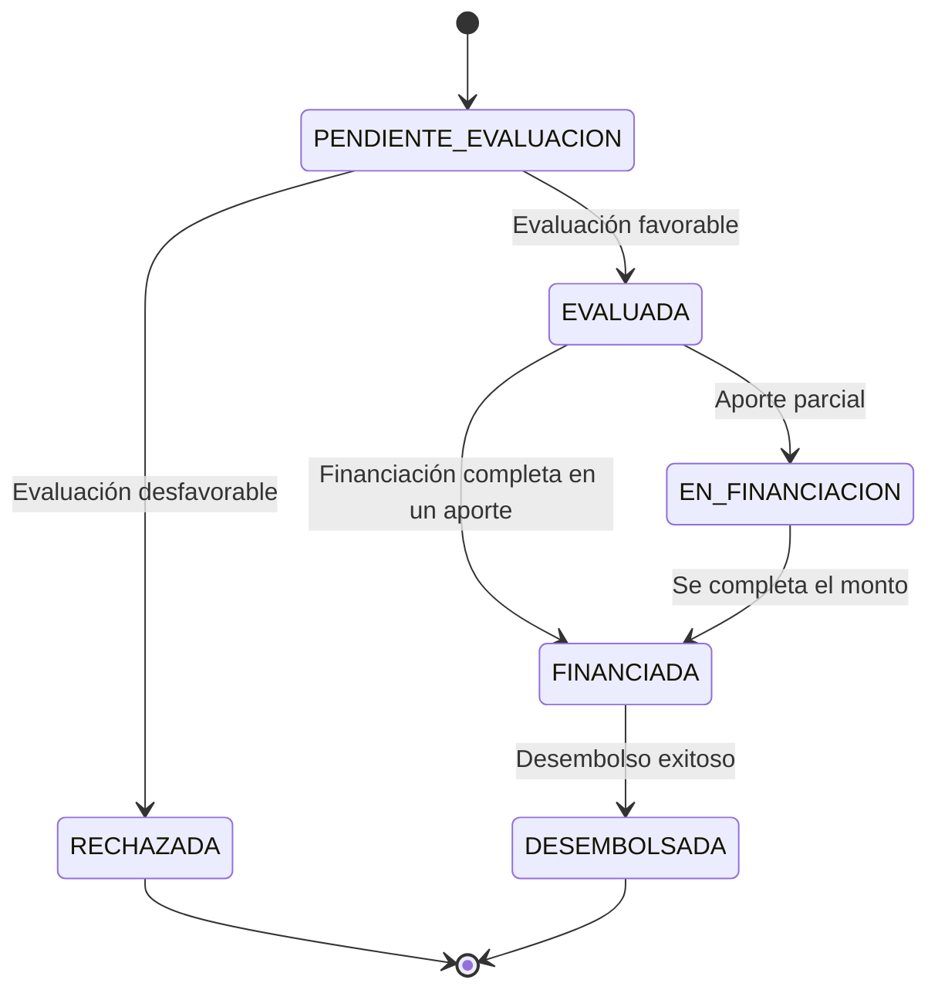
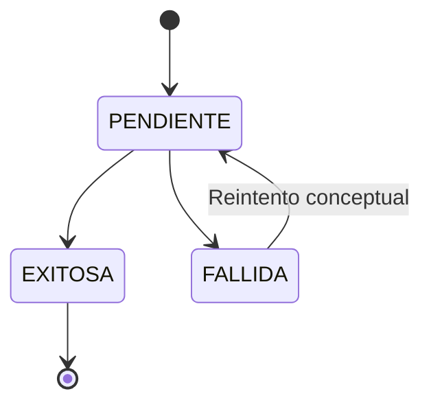

# Máquinas de estados de PayFast

Las reglas de transición se definen en `backend/app/domain/states.py`. Los servicios implementan las operaciones que modifican los estados de las solicitudes y las transacciones.

## 1. Estados de las solicitudes de crédito

Una solicitud nace en `PENDIENTE_EVALUACION`. La evaluación crediticia determina si pasa a `EVALUADA` o `RECHAZADA`.

Una solicitud evaluada favorablemente puede recibir financiación. Si el primer aporte es parcial, pasa a `EN_FINANCIACION`. Si cubre el monto total, pasa directamente a `FINANCIADA`.

Una solicitud `EN_FINANCIACION` permanece en ese estado mientras existan fondos pendientes y pasa a `FINANCIADA` cuando se completa el monto solicitado.

El desembolso exitoso cambia su estado a `DESEMBOLSADA`.

### Reglas de integridad

- No se permite financiar solicitudes pendientes de evaluación, rechazadas, financiadas o desembolsadas.
- Los aportes acumulados no pueden superar el monto solicitado.
- Una solicitud únicamente puede desembolsarse cuando está `FINANCIADA`.
- Una solicitud rechazada o desembolsada no admite nuevas transiciones.

## 2. Estados de las transacciones

La máquina de estados del dominio contempla los estados `PENDIENTE`, `EXITOSA` y `FALLIDA`.

## 3. Prevención de desembolsos duplicados

La prevención de desembolsos duplicados utiliza tres mecanismos:

1. Bloqueo de la solicitud mediante `SELECT ... FOR UPDATE` en PostgreSQL.
2. Comprobación de que no exista una transacción exitosa para la solicitud.
3. Índice único parcial sobre `solicitud_id` para las transacciones con estado `EXITOSA`.

El índice permite conservar varios intentos fallidos, pero impide registrar dos transacciones exitosas para una misma solicitud.